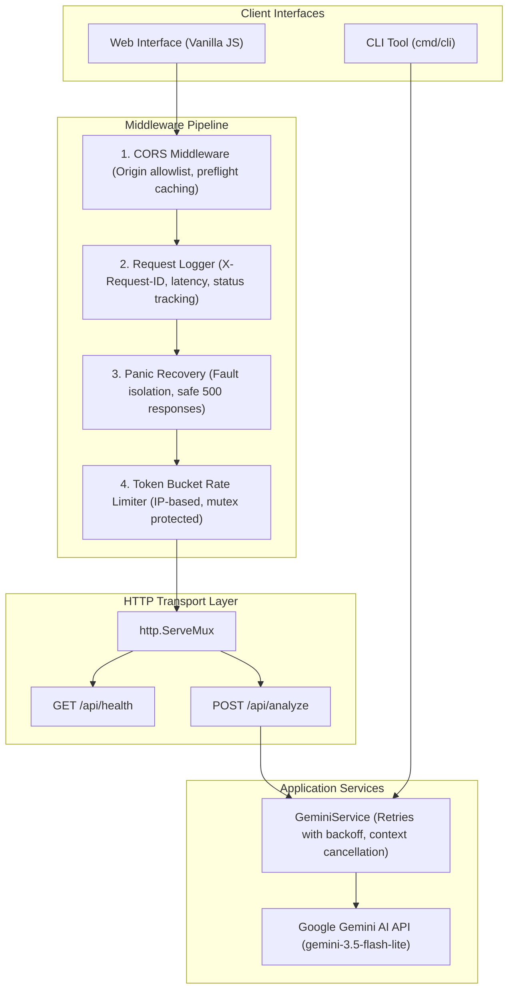

# ⚡ CommitLint.ai

[](https://github.com/07Durgesh/commitlint-ai/actions/workflows/ci.yml)
[](https://go.dev)
[](LICENSE)
[](https://conventionalcommits.org)
[](CONTRIBUTING.md)

> **Automated Git Intelligence:** Turn raw git diffs into clean Conventional Commits, structured PR descriptions, and actionable code health observations in milliseconds using Go and Gemini AI.

---

## 🏛️ System Architecture



---

## ✨ Features

- **Standard Library Go (`net/http`)**: Zero third-party web frameworks, showcasing deep standard library mastery and idiomatic Go design.
- **Resilient AI Pipeline**: Context-aware cancellation, exponential backoff retries, and strict JSON mode parsing.
- **Defensive API Hardening**:
  - Request body capping (`1MB`) to prevent Out-of-Memory (DoS) vulnerabilities.
  - Diff input validation with a 50,000 character ceiling.
  - Concurrency-safe in-memory Token Bucket rate limiter per IP with automatic stale visitor cleanup.
  - Full request tracing with `X-Request-ID` and structured latency logging.
  - Panic recovery middleware to guarantee 100% server uptime.
  - Graceful shutdown handling OS interrupt signals (`SIGINT`, `SIGTERM`).
- **Dual Interfaces**:
  - **Single Page Web Application**: Lightweight, dark-themed responsive UI with sample diff loaders and 1-click clipboard copying.
  - **Command Line Tool (`cmd/cli`)**: Run analysis directly from your terminal or pipe into git commands (`git diff | commitlint-cli`).

---

## 🚀 Quick Start

### 1. Prerequisites
- Go 1.21 or higher
- A free Gemini API key from [Google AI Studio](https://aistudio.google.com/apikey)

### 2. Configure Environment
Create a `.env` file in the root `commitlint-AI/` directory:
```env
GEMINI_API_KEY=your_gemini_api_key_here
PORT=8080
GEMINI_MODEL=gemini-3.5-flash-lite
```

### 3. Run Backend Server
```bash
cd backend
go run cmd/server/main.go
```
The server will start listening at `http://localhost:8080`.

### 4. Run CLI Tool
You can analyze diffs directly from your terminal:
```bash
# Pass diff directly
go run cmd/cli/main.go -diff "$(git diff)"

# Or pass a context note
go run cmd/cli/main.go -diff "$(git diff)" -context "refactored auth token refresh"

# Or pipe diff via stdin
git diff | go run cmd/cli/main.go
```

### 5. Open Web Frontend
Simply open `frontend/index.html` in your browser!

---

## 🔌 API Specification

### `POST /api/analyze`
**Request:**
```json
{
  "diff": "diff --git a/main.go b/main.go\n+func Health() string { return \"ok\" }",
  "context": "added health check helper",
  "style": "conventional"
}
```

**Response (200 OK):**
```json
{
  "commit_message": {
    "subject": "feat(core): add health check helper",
    "body": "Implement Health function returning service status.",
    "full": "feat(core): add health check helper\n\nImplement Health function returning service status."
  },
  "pr_description": {
    "what": "Adds a new Health function to report service status.",
    "why": "Enables upstream monitoring services to check application health.",
    "how": "Exposes a basic string response indicating ok state.",
    "full_markdown": "## What\nAdds a new Health function..."
  },
  "observations": [
    {
      "type": "suggestion",
      "message": "Consider accepting context.Context for cancellable health checks."
    }
  ]
}
```

### `GET /api/health`
**Response (200 OK):**
```json
{
  "status": "ok",
  "version": "0.1.0"
}
```

---

## 🧪 Running Tests
```bash
cd backend
go test -v ./...
```
Runs in-memory unit tests for all handlers and middleware with zero external dependencies.

---

## ⚖️ Engineering Decisions & Trade-Offs

| Decision | Alternative Considered | Trade-off Rationale |
|---|---|---|
| **Standard `net/http`** | Gin, Fiber, Echo | stdlib provides zero dependencies, rock-solid stability, and demonstrates foundational Go knowledge valued in GSoC. |
| **Token Bucket Limiter** | Redis Rate Limiter | In-memory limiter with `sync.Mutex` avoids external infrastructure overhead for single-instance deployments while providing microsecond enforcement. |
| **Closures for Handlers** | Struct Receivers | Closures provide clean dependency injection for lightweight services without struct boilerplate. |
| **Context Cancellation** | Unbounded HTTP calls | Canceling upstream Gemini calls when a client disconnects prevents wasted compute and token budget. |

