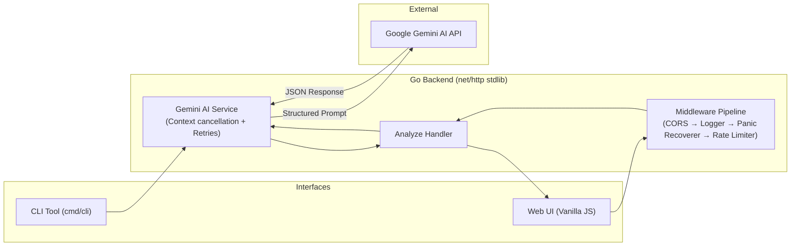

# ⚡ CommitLint.ai

[](https://commitlint-ai.vercel.app)
[](https://github.com/07Durgesh/Commitlint-AI/actions/workflows/ci.yml)
[](https://go.dev)
[](LICENSE)
[](https://ai.google.dev)

> **"Never write a lazy commit message again."**  
> An automated Git intelligence tool that turns raw `git diff` outputs into clean Conventional Commits, structured PR descriptions, and actionable code review observations using Go and Gemini AI.  
> 🔗 **Live App:** [https://commitlint-ai.vercel.app](https://commitlint-ai.vercel.app)

---

## 💡 Why I Built This

Every developer has been guilty of writing vague commit messages like `fix stuff`, `updates`, or `wip`, or spending 15 minutes drafting a Pull Request summary when they just want to ship code.

I built **CommitLint.ai** to solve two personal needs:
1. **A practical daily tool:** A CLI that I can pipe directly into `git diff` right in my terminal, plus a clean web UI for quick pastes.
2. **A deep dive into Go backend engineering:** Instead of reaching for heavy third-party web frameworks (like Gin or Fiber) or bloated npm dependencies, I wanted to build this using **Go's standard library (`net/http`) from scratch** to truly understand HTTP primitives, concurrency safety with mutexes, rate limiting algorithms, and resilient API design.

---

## 🏛️ How It Works



---

## 🛠️ Key Technical Highlights

Here are some of the interesting backend engineering challenges I tackled in this project:

- **Zero-Framework Go Backend:** Everything is built using standard library `net/http` and `http.ServeMux`. Handlers use closure-based dependency injection to isolate the Gemini service cleanly.
- **In-Memory Token-Bucket Rate Limiter:** Built a concurrent-safe rate limiter from scratch using `sync.Mutex` and token bucket math. Includes a background `time.Ticker` goroutine that automatically sweeps inactive visitor IPs to prevent memory leaks. Also inspects `X-Forwarded-For` for reverse-proxy compatibility.
- **Defensive API Hardening:**
  - `http.MaxBytesReader` caps inbound payloads at 1MB to prevent Out-of-Memory (DoS) attacks.
  - Diff input size is validated with a 50,000 character ceiling.
  - Panic recovery middleware intercepts any runtime panics, logs full stack traces, and returns safe 500 JSON responses so the Go process never crashes.
- **Resilient AI Pipeline:**
  - **Context-Aware Cancellation:** Outbound Gemini requests respect `r.Context()`. If a client aborts or closes the browser tab, the upstream AI request terminates immediately to save tokens and CPU.
  - **Exponential Backoff Retries:** Automatically retries transient 5xx server errors and 429 rate limit errors from Gemini with exponential backoff.
  - **Strict JSON Mode:** Configured with `responseMimeType: "application/json"` to ensure deterministic JSON parsing without markdown regex hacks.
- **Dynamic Build Versioning:** Injects the Git commit SHA, release tag, and build timestamp directly into the binary at compile time using Go linker flags (`-ldflags -X`), which are served live on `GET /api/health`.
- **UNIX-Style CLI Tool:** The CLI binary (`cmd/cli`) reuses the exact same backend service logic, allowing developers to pipe diffs directly from Git: `git diff | commitlint-cli`.

---

## 🚀 Quickstart

### 1. Prerequisites
- Go 1.21+ installed
- A free Gemini API key from [Google AI Studio](https://aistudio.google.com/apikey)

### 2. Setup
```bash
git clone https://github.com/07Durgesh/Commitlint-AI.git
cd Commitlint-AI

# Create .env from template
cp .env.example .env
# Add your GEMINI_API_KEY in .env
```

### 3. Run the Backend Server
```bash
cd backend
go run cmd/server/main.go
```
The server will start on `http://localhost:8080`.

### 4. Try the CLI
You can test the CLI immediately in your terminal:
```bash
cd backend

# Pass a diff directly
go run cmd/cli/main.go -diff "diff --git a/auth/jwt.go b/auth/jwt.go`n+func GenerateToken(userID string) (string, error)"

# Pipe git diff directly
git diff | go run cmd/cli/main.go

# Print only the commit subject
git diff | go run cmd/cli/main.go -commit-only
```

### 5. Open the Web UI
Simply double-click `frontend/index.html` in your file explorer or open it in your browser. Click **"Load Sample Diff"** and hit **"✨ Generate Commit & PR"**!

---

## 🧪 Running Tests

All unit tests run in-memory using Go's `net/http/httptest` package in milliseconds:
```bash
cd backend
go test -v ./...
```

---

## ⚖️ Engineering Decisions & Trade-offs

| Decision | Alternative Considered | Why I Chose This |
|---|---|---|
| **Go `net/http` stdlib** | Gin, Fiber, Echo | stdlib has zero external dependencies, guarantees rock-solid stability, and forced me to understand the core HTTP mechanics. |
| **In-Memory Token Bucket** | Redis / Memcached | Avoided the overhead of hosting external Redis instances for a single-server deployment while achieving sub-microsecond enforcement. |
| **Compile-Time `-ldflags`** | Hardcoded version constants | Links the immutable Git commit SHA and release tag at build time with zero runtime disk reads. |
| **Separated Hosting (Render + Vercel)** | Single monolithic server | Static frontend runs on global CDN edges for microsecond load times; Go backend scales independently. |

---

## 👤 Author

Built by **Durgesh** — B.Tech Computer Science student passionate about Go, backend systems, and developer tooling.

- GitHub: [@07Durgesh](https://github.com/07Durgesh)
- Project Repository: [github.com/07Durgesh/Commitlint-AI](https://github.com/07Durgesh/Commitlint-AI)

Feel free to open an issue or star the repository if you found this useful! ⭐
