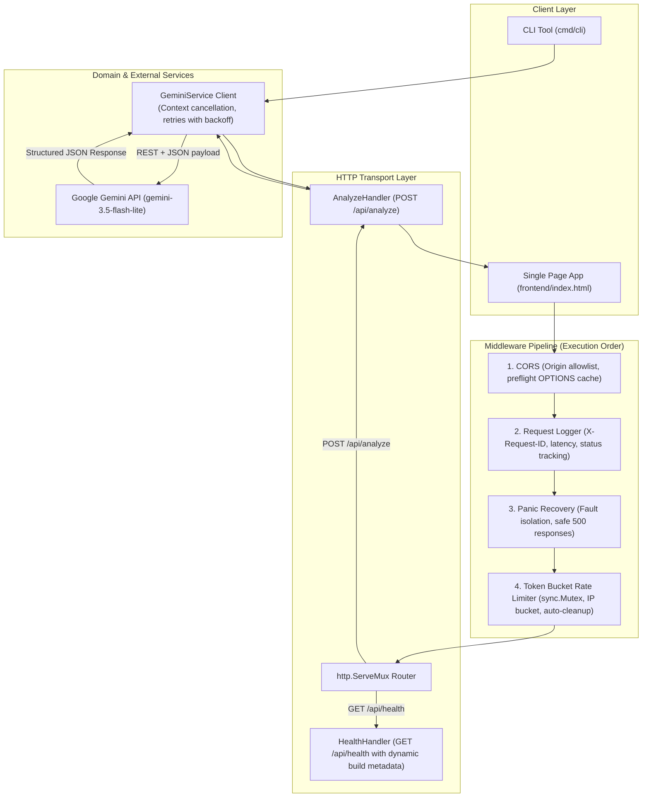

# 📘 CommitLint.ai — Engineering Guide & Living Learning Journal

> **Purpose:** This document is your comprehensive learning companion and step-by-step record of building **CommitLint.ai**. It tracks what was built, how it was built, why architectural decisions were made, and the engineering trade-offs of every choice.

---

## 📑 Table of Contents
1. [Architecture & System Overview](#1-architecture--system-overview)
2. [Chronological Build Log & Progress Tracker](#2-chronological-build-log--progress-tracker)
3. [Step 1: Domain Modeling (`internal/model/types.go`)](#3-step-1-domain-modeling-internalmodeltypesgo)
4. [Step 2: AI Service Integration & Resilience (`internal/service/gemini.go`)](#4-step-2-ai-service-integration--resilience-internalservicegeminigo)
5. [Step 3: HTTP Handler Layer (`internal/handler/`)](#5-step-3-http-handler-layer-internalhandler)
6. [Step 4: Middleware Pipeline (`internal/middleware/`)](#6-step-4-middleware-pipeline-internalmiddleware)
7. [Step 5: Dynamic Versioning via Linker Flags (`-ldflags`)](#7-step-5-dynamic-versioning-via-linker-flags--ldflags)
8. [Step 6: Server Entrypoint & Graceful Shutdown (`cmd/server/main.go`)](#8-step-6-server-entrypoint--graceful-shutdown-cmdservermaingo)
9. [Step 7: CLI Tool & Architecture Decoupling (`cmd/cli/main.go`)](#9-step-7-cli-tool--architecture-decoupling-cmdclimainego)
10. [Step 8: Automated CI/CD Pipeline (GitHub Actions)](#10-step-8-automated-cicd-pipeline-github-actions)
11. [Step 9: Multi-Platform Release Distribution Workflow](#11-step-9-multi-platform-release-distribution-workflow)
12. [Step 10: Open-Source Community Standards & Repo Hygiene](#12-step-10-open-source-community-standards--repo-hygiene)
13. [Step 11: Production Change & Version Management](#13-step-11-production-change--version-management)
14. [Comprehensive Trade-offs Matrix](#14-comprehensive-trade-offs-matrix)

---

## 1. Architecture & System Overview

CommitLint.ai is an automated Git intelligence tool. Developers provide a `git diff`, and the tool generates Conventional Commit messages, structured Pull Request descriptions, and code health observations.

### Complete System Topology



---

## 2. Chronological Build Log & Progress Tracker

| Stage | Component | File(s) | Status | Key Concept Learned |
|---|---|---|---|---|
| **Phase 1.1** | Domain Models | `internal/model/types.go` | ✅ Completed | Struct tags, JSON serialization, `omitempty` |
| **Phase 1.2** | Gemini API Service | `internal/service/gemini.go` | ✅ Completed | `http.Client` reuse, context cancellation, retry backoff |
| **Phase 1.3** | Health & Analyze Handlers | `internal/handler/health.go`, `analyze.go` | ✅ Completed | `http.HandlerFunc`, closures for DI, defensive validation, DoS mitigation |
| **Phase 1.4** | CORS Middleware | `internal/middleware/cors.go` | ✅ Completed | Same-Origin Policy, preflight `OPTIONS`, 24h preflight cache |
| **Phase 1.5** | Rate Limiter Middleware | `internal/middleware/ratelimit.go` | ✅ Completed | Token bucket algorithm, `sync.Mutex`, IP extraction, memory leaks |
| **Phase 1.6** | Request Tracing & Logger | `internal/middleware/logger.go` | ✅ Completed | Intercepting status codes via struct embedding, `X-Request-ID` |
| **Phase 1.7** | Panic Recovery | `internal/middleware/recover.go` | ✅ Completed | `defer`, `recover()`, stack trace capture, zero-crash servers |
| **Phase 1.8** | Server & Graceful Shutdown | `cmd/server/main.go` | ✅ Completed | `http.Server`, signal handling (`SIGINT`/`SIGTERM`), graceful drainage |
| **Phase 2.1** | Standalone CLI Tool | `cmd/cli/main.go` | ✅ Completed | Stdin streaming, CLI flags, business logic decoupling |
| **Phase 2.2** | Lightweight Frontend | `frontend/index.html`, `style.css`, `app.js` | ✅ Completed | Vanilla JS Fetch, Clipboard API, dark developer UI |
| **Phase 3.1** | Compile-Time Versioning | `main.go`, `cli/main.go`, `health.go` | ✅ Completed | Linker flags (`-ldflags -X`), zero-runtime overhead metadata |
| **Phase 3.2** | Continuous Integration (CI) | `.github/workflows/ci.yml` | ✅ Completed | Automated testing, `go vet`, coverage profiles, build verification |
| **Phase 3.3** | Release Distribution (CD) | `.github/workflows/release.yml` | ✅ Completed | Cross-compilation for 5 OS/architectures, checksums, GitHub Releases |
| **Phase 3.4** | Cloud Infrastructure (IaC) | `render.yaml`, `vercel.json` | ✅ Completed | Infrastructure-as-code, health probes, environment separation |
| **Phase 3.5** | GitHub Production Release | Tag `v1.0.0` pushed | ✅ Live on GitHub | Branch `main`, release workflows triggered, community hygiene files |

---

## 3. Step 1: Domain Modeling (`internal/model/types.go`)

Defined the contract between clients, the Go backend, and the Gemini API.
- **Exported Identifiers:** Uppercase struct fields (`Diff`, `Subject`) allow `encoding/json` reflection across package boundaries.
- **Struct Tags:** Standardized JSON formatting (`json:"commit_message"`).
- **`omitempty`:** Eliminates redundant empty keys from API payloads.

---

## 4. Step 2: AI Service Integration & Resilience (`internal/service/gemini.go`)

### Resilience Patterns Implemented
1. **Context-Aware Cancellation (`http.NewRequestWithContext`):**
   When a user cancels or closes their browser tab, `r.Context()` is canceled. Outbound Gemini requests abort immediately, saving token quota and server CPU.
2. **Exponential Backoff & Retries:**
   Transient errors (500, 502, 503, 504, 429) automatically retry up to 2 times with a backoff delay.
3. **Dynamic Model Resolution (`gemini-3.5-flash-lite`):**
   Reads `GEMINI_MODEL` from environment, defaulting to `gemini-3.5-flash-lite` for minimal latency and high availability.
4. **Structured JSON Mode:**
   `responseMimeType: "application/json"` guarantees deterministic JSON without markdown code fences.

---

## 5. Step 3: HTTP Handler Layer (`internal/handler/`)

### Defensive API Protections
1. **DoS Body Capping:**
   `r.Body = http.MaxBytesReader(w, r.Body, 1024 * 1024)` cuts off oversized payloads before reading into memory.
2. **Input Validation:**
   - Diffs cannot be empty or whitespace.
   - Max 50,000 character limit.
   - Commit style allowlist validation (`conventional`, `angular`, `simple`).

---

## 6. Step 4: Middleware Pipeline (`internal/middleware/`)

### Pipeline Order
```
Incoming Request → [CORS] → [Logger] → [Recoverer] → [RateLimiter] → [ServeMux]
```
1. **CORS:** Answers `OPTIONS` preflight with `204 No Content` and caches permission for 24 hours.
2. **Logger:** Uses **Struct Embedding** on `http.ResponseWriter` to capture status codes, logs duration, and injects `X-Request-ID`.
3. **Recoverer:** Catches panics via `defer`/`recover()`, logs stack traces, and returns safe `500` JSON errors.
4. **RateLimiter:** Token bucket per client IP protected by `sync.Mutex`, with automated background cleanup for inactive IPs.

---

## 7. Step 5: Dynamic Versioning via Linker Flags (`-ldflags`)

### The Solution: Go Linker String Replacement
Go's linker allows setting the value of package-level string variables at build time using `-X`:

```bash
go build -ldflags "-X main.Version=v1.0.0 -X main.Commit=7a8b9c1 -X main.BuildDate=2026-10-28"
```

In `cmd/server/main.go` and `cmd/cli/main.go`:
```go
var (
    Version   = "dev"
    Commit    = "none"
    BuildDate = "unknown"
)
```
- **Zero Runtime Overhead:** Values are hardcoded into the binary text segment by the linker. No file reading or disk I/O required.
- **Observability:** `GET /api/health` returns `{ "status": "ok", "version": "v1.0.0", "commit": "7a8b9c1" }`, allowing monitoring tools to know the exact build deployed.

---

## 8. Step 6: Server Entrypoint & Graceful Shutdown (`cmd/server/main.go`)

Catches `SIGINT` (Ctrl+C) and `SIGTERM` (container termination), providing a 10-second timeout for active in-flight requests to complete before closing listeners:

```go
quit := make(chan os.Signal, 1)
signal.Notify(quit, os.Interrupt, syscall.SIGTERM)
<-quit

ctx, cancel := context.WithTimeout(context.Background(), 10*time.Second)
defer cancel()
server.Shutdown(ctx)
```

---

## 9. Step 7: CLI Tool & Architecture Decoupling (`cmd/cli/main.go`)

Decoupling business logic into `internal/service/gemini.go` enables both the HTTP server and CLI binary to share identical core analysis logic. Supports:
- `-diff "..."` direct flag input.
- `-file patch.diff` file reading.
- Piping via stdin (`git diff | commitlint-cli`).
- `-version` build metadata reporting.

---

## 10. Step 8: Automated CI/CD Pipeline (GitHub Actions)

📄 **File: `.github/workflows/ci.yml`**
- **Triggers:** On every push or pull request to `main` / `master`.
- **Steps:**
  1. Checks out repository.
  2. Sets up Go 1.22 with module caching.
  3. Runs `go mod verify`.
  4. Runs static analysis via `go vet ./...`.
  5. Executes full unit test suite with coverage (`go test -v -coverprofile=coverage.out ./...`).
  6. Compiles both server and CLI binaries with Git SHA metadata.

---

## 11. Step 9: Multi-Platform Release Distribution Workflow

📄 **File: `.github/workflows/release.yml`**
- **Triggers:** Whenever a Git tag matching `v*` is pushed (`git tag v1.0.0 && git push origin v1.0.0`).
- **Cross-Compilation:** Produces native binaries for:
  - `linux/amd64` & `linux/arm64`
  - `darwin/amd64` & `darwin/arm64` (Apple Silicon)
  - `windows/amd64`
- **Integrity Checksums:** Generates `checksums.txt` using `sha256sum`.
- **GitHub Release:** Publishes binaries directly to GitHub Releases.

---

## 12. Step 10: Open-Source Community Standards & Repo Hygiene

To ensure the repository reflects top-tier production quality for reviewers and open-source contributors:
1. **`LICENSE`:** Standard MIT open-source license.
2. **`CONTRIBUTING.md`:** Comprehensive contributor guidelines with setup, testing instructions, and Conventional Commit rules.
3. **`CODE_OF_CONDUCT.md`:** Contributor Covenant standard.
4. **`PULL_REQUEST_TEMPLATE.md`:** Standardized PR description format with testing checklists.
5. **Issue Templates:** Structured bug report and feature request templates in `.github/ISSUE_TEMPLATE/`.
6. **Badges:** Added dynamic GitHub Actions CI build status, Go version, and MIT license badges to `README.md`.

---

## 13. Step 11: Production Change & Version Management

### How to Version & Deploy Changes
1. **Semantic Versioning (`vMAJOR.MINOR.PATCH`):**
   - `PATCH` (e.g. `v1.0.1`): Bug fixes, error message adjustments.
   - `MINOR` (e.g. `v1.1.0`): Backwards-compatible new features (e.g. new style option, history API).
   - `MAJOR` (e.g. `v2.0.0`): Breaking changes to request/response schemas.
2. **The Release Lifecycle:**
   ```bash
   # 1. Develop on a feature branch
   git checkout -b feat/add-history
   
   # 2. Run local tests
   go test -v ./...
   
   # 3. Commit using Conventional Commits
   git commit -m "feat(history): implement sqlite generation history"
   
   # 4. Push and open PR -> GitHub Actions CI tests automatically!
   git push origin feat/add-history
   
   # 5. Merge into main -> Render deploys the updated backend automatically!
   
   # 6. Cut a release tag -> GitHub Actions builds binaries automatically!
   git tag v1.1.0
   git push origin v1.1.0
   ```

---

## 14. Comprehensive Trade-offs Matrix

| Architectural Choice | Alternative Considered | Why We Chose Our Approach |
|---|---|---|
| **Linker Flag Versioning (`-ldflags`)** | Hardcoded version constants or config files | Injects immutable Git commit SHA and release tag at build time without disk reads. |
| **GitHub Actions CI** | Manual developer testing | Guarantees that broken code or failing tests can never be merged into production. |
| **Cross-Compilation in CI** | Building on each native OS machine | Go's compiler compiles for any OS/arch natively (`GOOS`/`GOARCH`), avoiding costly VM runners. |
| **Separated Hosting (Render + Vercel)** | Single monolithic server | Static frontend runs on global CDN edges for microsecond load times; backend scales independently on Go runtime. |
| **Token Bucket Limiter** | Redis / memcached | In-memory limiter with `sync.Mutex` avoids external infrastructure overhead while providing microsecond latency. |
